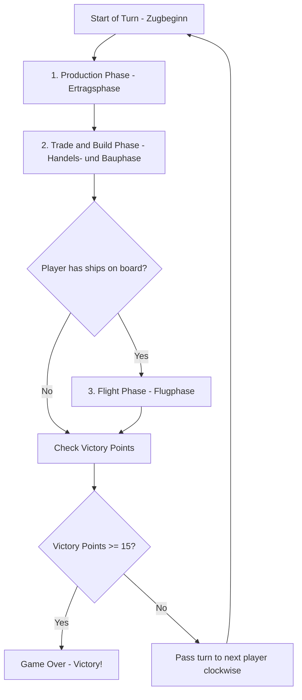
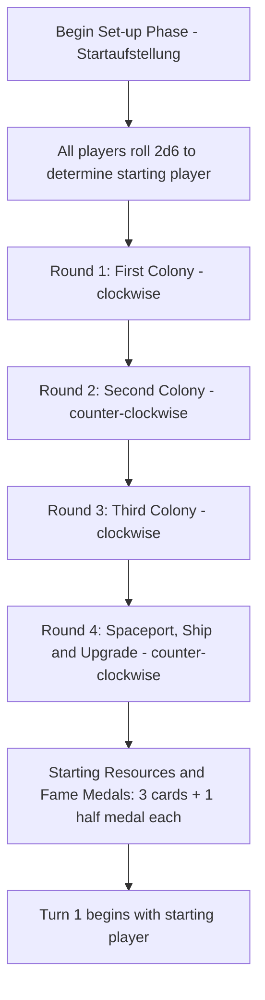
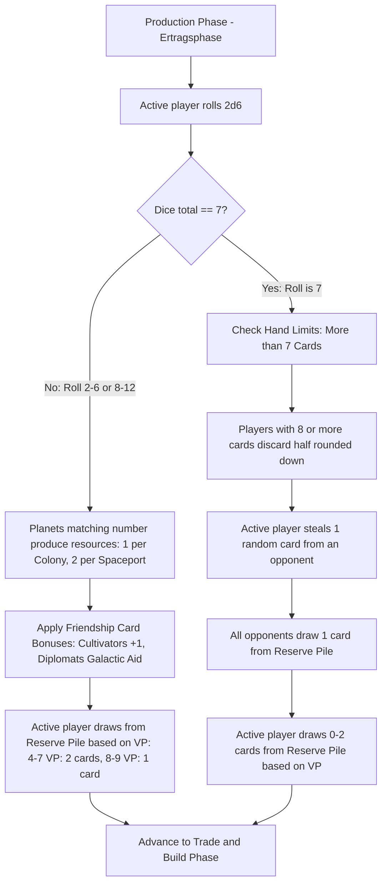
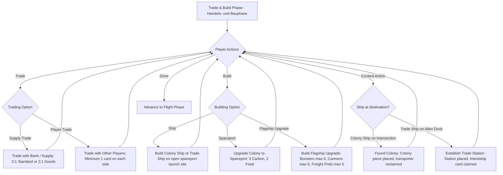
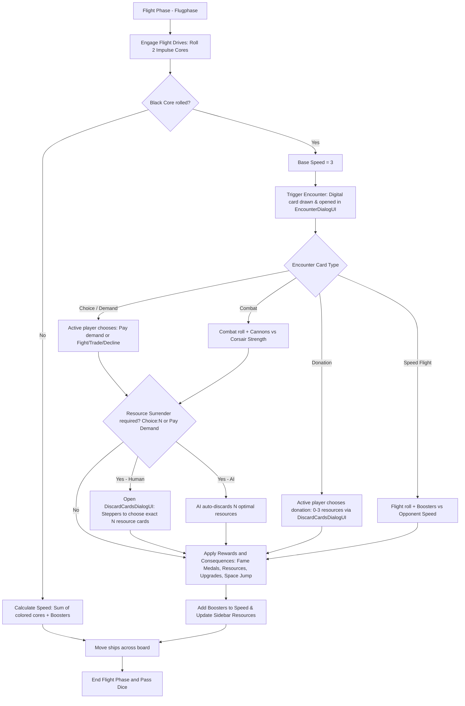
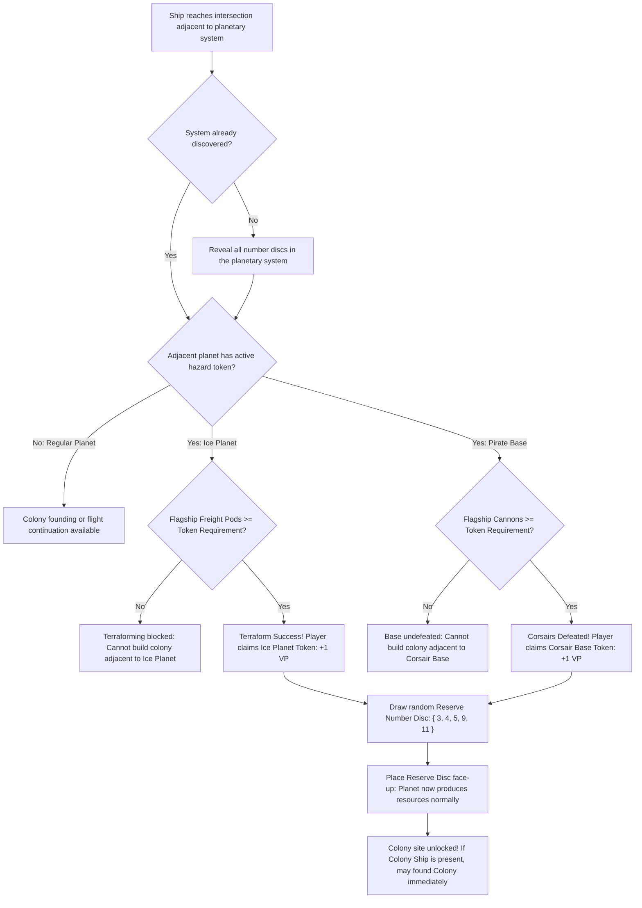
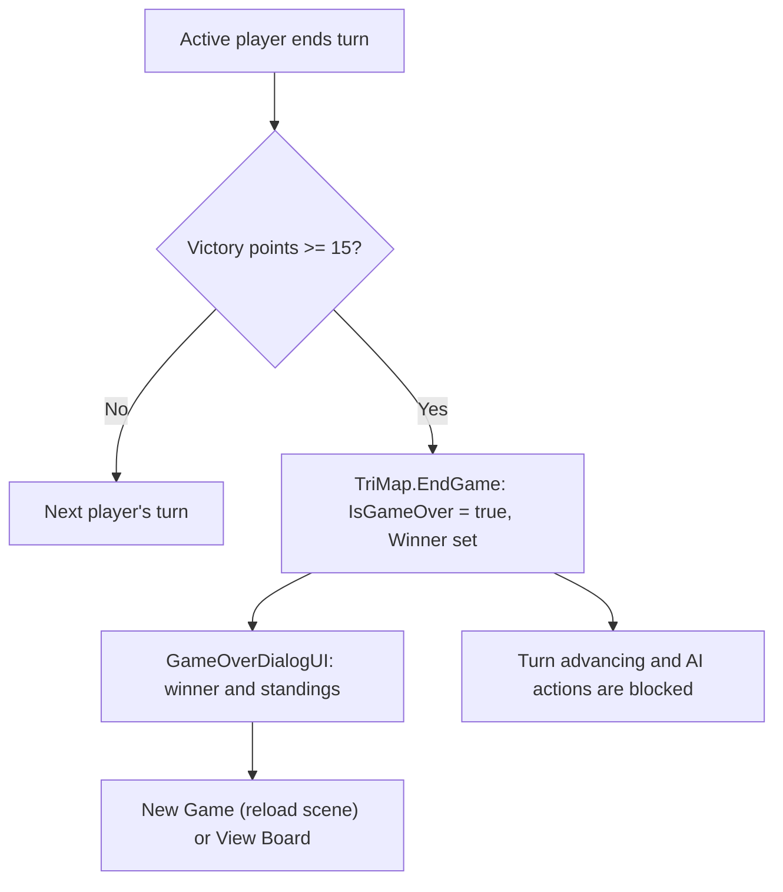

# Deep Space Pioneers

Unity project for **Deep Space Pioneers**, an original digital space-exploration and colonization board game. Players build and navigate colony and trade ships across variable interstellar sectors, colonize planetary systems, trade with distinct alien civilizations, upgrade flagship modules, and confront deep-space hazards.

> **Language & Style Policy:**
> - All documentation, technical notes, and new entries in `README.md` must be written in **English**.
> - All code comments and newly introduced code identifiers must be in **English**.

---

## German – English Terminology Reference

The following table provides the bilingual terminology mapping between the German and English language versions of Deep Space Pioneers:

| German Term (DE) | English Term (EN) | Description / Context |
|---|---|---|
| **Raumpunkt** | **Intersection** | Vertex on the space hex grid; waypoint for ship movement. |
| **Koloniebauplatz** | **Colony Site** | Special intersection situated between two planets of a system where a colony can be established. |
| **Kolonie** | **Colony** | Settlement established on a colony site using a colony ship. |
| **Raumhafen** | **Spaceport** | Upgraded colony featuring shipyards to launch new ships. |
| **Raumhafenpunkt** | **Spaceport Site** | The two intersections directly adjacent to a spaceport where ships are launched. |
| **Raumquadrant** | **Sector** | 3-hex tile piece placed on the board; can contain planetary systems, outposts, or empty space. |
| **Planetensystem** | **Planetary System** | A sector containing 3 planets and 3 colony sites. |
| **Außenposten** | **Outpost** | Station belonging to an alien civilization with docking points. |
| **Handelsstation** | **Trade Station** | Player station established on a docking point at an alien outpost using a trade ship. |
| **Dock / Dockplatz** | **Docking Point** | Landing intersection situated at an outpost. |
| **Zahlenchip** | **Number Disc** | Token placed on a planet indicating its resource production number. |
| **Reserve-Zahlenchip** | **Reserve Number Disc** | Replacement number disc drawn from the reserve pile after defeating pirates or terraforming. |
| **Eisplanet** | **Ice Planet** | Planetary system obstacle requiring freight pods and terraforming to utilize. |
| **Piratenstützpunkt** | **Pirate Base** | Planetary obstacle requiring combat cannons to defeat before use. |
| **Entdecken** | **Discover** | Flipping face-down sectors over upon a ship reaching an adjacent intersection. |
| **Erkunden** | **Explore** | Revealing face-down planet number discs upon a ship reaching an adjacent intersection. |
| **Rohstoffe** | **Resources** | The five card types produced by planets: |
| - *Erz* | - **Ore** | Production resource. |
| - *Treibstoff* | - **Fuel** | Production resource. |
| - *Carbon* | - **Carbon** | Production resource. |
| - *Nahrung* | - **Food** | Production resource. |
| **Flaggschiff** (*ehem. Mutterschiff*) | **Flagship** (*formerly Mothership*) | The player's primary command vessel; upgrades determine fleet speed, combat strength, and cargo capacity. |
| **Antrieb** | **Booster** | Flagship drive upgrade increasing ship speed. |
| **Bordkanone** | **Cannon** | Flagship armament upgrade increasing combat strength. |
| **Frachtmodul** | **Freight Pod** | Flagship cargo pod upgrade increasing trade station capacity and ice planet terraforming ability. |
| **Kolonieschiff** | **Colony Ship** | Transport ship carrying a colony. |
| **Handelsschiff** | **Trade Ship** | Transport ship carrying a trade station. |
| **Transportschiff** | **Transport Ship** | Generic category encompassing colony ships and trade ships. |
| **Impuls-Kern** | **Flight Impulse Core** | Core power result (Black, Blue, Yellow, Red) determining sub-light impulse speed or encounters. |
| **Halbe Medaille / Ruhmesmedaille** | **Fame Medal Piece / Fame Medal** | Awarded during encounters/tasks; two pieces combine into 1 Victory Point. |
| **Ertragsphase** | **Production Phase** | Turn phase where dice are rolled to determine resource yields. |
| **Handels- und Bauphase** | **Trade & Build Phase** | Turn phase for trading resources and building ships/upgrades. |
| **Flugphase / Bewegungsphase** | **Flight Phase** | Turn phase where flight drives are engaged and player moves ships across intersections. |
| **Gründungsphase** | **Set-up Phase (Variable Set-up)** | 4-round initial placement procedure prior to the first regular turn. |
| **Begegnung / Begegnungskarte** | **Encounter / Encounter Card** | Event triggered when a black impulse core is drawn during flight drive engagement. |
| **Freundschaftskarte** | **Friendship Card** | Reward card granted by alien civilizations for establishing trade stations. |
| **Freundschaftsmarkierung** | **Friendship Marker** | Marker tracking relations on alien civilization tracks. |
| **Siegpunkte** | **Victory Points** | Victory threshold (15 VPs to win). |
| **Raumsprung** | **Space Jump** | Instantaneous spatial transition through hyperspace or wormholes. |
| **Wurmloch** | **Wormhole** | Board anomaly connecting distant space regions. |

---

## Project Status & Architecture

The current prototype includes a triangular grid board structure, star systems, players, ships/units, colonies, trade stations, and turn/selection states:

- [`Assets/Scripts/TriMap.cs`](Assets/Scripts/TriMap.cs) – Map and game manager, board instantiation, system registration, visual markers.
- [`Assets/Scripts/Tri.cs`](Assets/Scripts/Tri.cs) – Grid intersection (tile) node, coordinate logic, neighbors, and system information.
- [`Assets/Scripts/Player.cs`](Assets/Scripts/Player.cs) – Player state, resources, victory points, and mothership upgrades.
- [`Assets/Scripts/PlayerHandler.cs`](Assets/Scripts/PlayerHandler.cs) – UI controller displaying active player cards, resources, and turn phases.
- [`Assets/Scripts/Unit.cs`](Assets/Scripts/Unit.cs) – Ship unit movement, movement budget, and path traversal.
- [`Assets/Scripts/Colony.cs`](Assets/Scripts/Colony.cs) & [`Assets/Scripts/TradeStation.cs`](Assets/Scripts/TradeStation.cs) – Built game structures.
- [`Assets/Scripts/ControllerStates/`](Assets/Scripts/ControllerStates/) – Input handling and state machine states.
- [`Assets/QPath/`](Assets/QPath/) – A* pathfinding graph and priority queues.

The grid system is modeled as a 3-regular graph where each `Tri` represents an **intersection** (Raumpunkt). The dual of this graph forms hexagonal space cells. The game supports two board variations:
- [`Assets/Scripts/TriMapSF.cs`](Assets/Scripts/TriMapSF.cs) models the legacy fixed board configuration.
- [`Assets/Scripts/TriMapSFnew.cs`](Assets/Scripts/TriMapSFnew.cs) models the revised board layout with starter home systems and variable space sectors.

Both board scripts capture a runtime board snapshot (`GameBoardModel`, defined in [`Assets/Scripts/GameRules.cs`](Assets/Scripts/GameRules.cs)). For planetary systems, the model tracks passability, resource types, and production numbers. At game start, only the four home systems (α, β, γ, δ) have their numbers initially revealed; all other planetary systems start with face-down number discs.

### Planetary System Discovery & Exploration Mechanics

According to the **Discovery & Exploration Rules** (*"Discover"* and *"Explore"*):
- Each planetary system occupies a 3-hex sector consisting of 3 planets.
- Symmetrically surrounding the 3 planets, there are **exactly nine (9) outer boundary intersections** (3 outer vertex intersections per planet: $3 \times 3 = 9$).
- In between each pair of planets lie the **three (3) colony sites** (indentations).
- When a ship reaches any of the 9 outer discovery intersections adjacent to a planetary system during its flight, the planetary system is discovered and all its number discs are immediately revealed.
- Any ship approaching from outer space must pass through one of these 9 outer discovery intersections before entering a colony site. As a safeguard, entering a colony site directly also reveals adjacent systems.
- Discovery intersections are registered during board setup directly on each `Tri` node via `GetPlanetSystemAdjacentIntersections()`.

### Central Debug & Developer Settings (`GameDebugSettings`)

All developer, debugging, visual overlay, and board randomization switches are centralized in [`GameDebugSettings.cs`](Assets/Scripts/GameDebugSettings.cs) and exposed directly at the top of the Unity Inspector on the `TriMap` GameObject (`TriMapSFnew`). They are also globally accessible in code via `TriMap.DebugSettings` and `GameDebugSettings.Active`.

- **Board Seed & Randomization:**
  - `UseFixedBoardSeed` (bool): Check to use a deterministic fixed seed; uncheck to generate a fresh random seed every game start.
  - `FixedBoardSeed` (int): The deterministic seed value (defaults to `20261004`). When `UseFixedBoardSeed` is enabled, both sector distribution (`System.Random`) and planet production number rolls (`UnityEngine.Random`) are fully reproducible.
  - `LastGeneratedSeed` (int, info): Displays the actual seed utilized during the last board generation.
- **Visual Debug Overlays:**
  - `ShowCoordinateLabels` (bool, hotkey `F1`): Toggles coordinate text (`Q, R`) labels on all board intersections in real time.
  - `HighlightPlanetDiscoveryPoints` (bool, hotkey `F2`): Toggles green ring markers and coordinate text on the 9 discovery intersections around each planetary system.
  - `DrawDiscoveryGizmos` (bool, hotkey `F3`): Toggles wire sphere gizmos in the Unity Scene view.
- **Diagnostics & Logging:**
  - `PlanetDiscoveryDiagnostics` (bool): Toggles verbose `[PlanetDiscovery]` diagnostic logs (movement callbacks, registration checks, number disc revelation).
  - `LogTurnTransitions` (bool): Toggles turn start and roll summaries.
- **Test Modes:**
  - `PlanetDiscoveryTestMode` (bool): Automatically sets up a deterministic one-move planet-discovery test instead of the regular founding phase.

### Alien Outposts

Both board variants feature four foreign alien outposts. Each outpost has an outpost core and five visible docking points arranged evenly around the core. Player trade ships land on an open docking point to establish a trade station. The five docks are managed in [`Tri.cs`](Assets/Scripts/Tri.cs) and [`TriMap.cs`](Assets/Scripts/TriMap.cs).

### Multiplayer & Networking Architecture (LAN & Dedicated Server)

Deep Space Pioneers features an authoritative multiplayer architecture supporting both peer-hosted games (Host-and-Play) and dedicated headless servers over LAN:

- **Authoritative Game Server ([`Assets/Scripts/Networking/GameServer.cs`](Assets/Scripts/Networking/GameServer.cs)):**
  - Listens on TCP port `7777` with 4-byte length-prefixed JSON packet framing ([`Assets/Scripts/Networking/NetworkProtocol.cs`](Assets/Scripts/Networking/NetworkProtocol.cs)).
  - Manages client sessions, slot assignments, and lobby readiness.
  - Receives player actions (dice rolls, upgrades, founding colonies, trade stations, ship movement) and executes them authoritatively via the central game engine bridge.
  - **Fog of War & Secret Information Masking:** Before broadcasting state snapshots to a player, the server masks all opponent resource cards (`GameStateMaskingExtensions.CreateMaskedCopy()` in [`Assets/Scripts/AgentBridge/AgentBridgeDTOs.cs`](Assets/Scripts/AgentBridge/AgentBridgeDTOs.cs)). Opponents only see total card counts, preventing any client-side cheating.
- **LAN Discovery & Server Browser ([`Assets/Scripts/Networking/LanDiscovery.cs`](Assets/Scripts/Networking/LanDiscovery.cs)):**
  - Servers periodically broadcast UDP announcement beacons on port `7776` (server name, player count, state, TCP port).
  - Client discovery listeners dynamically populate the live LAN server browser with 1-click "Join" functionality and automatically prune unreachable servers after 4.5 seconds.
  - Direct IP/Port manual connection is also available.
- **Dedicated Headless Server Support:**
  - The standalone build can be launched in headless server mode via command-line arguments:
    ```bash
    ./DeepSpacePioneers.x86_64 -batchmode -nographics -server -port:7777 -name:"Deep Space Server"
    ```
- **Lobby & Setup Dialog Integration ([`Assets/Scripts/UI/GameSetupDialogUI.cs`](Assets/Scripts/UI/GameSetupDialogUI.cs)):**
  - **👥 Lokales Spiel:** Classic local pass-and-play hotseat mode against AI opponents.
  - **🌐 Server suchen (LAN):** Live LAN server browser with discovery list and direct IP connect.
  - **🚀 LAN hosten:** Configure server name and port, open a room, and host a match.

---

## Controls & Keybindings

The game supports the following keyboard shortcuts and mouse controls during play:

| Input / Shortcut | Action | System / Component |
|---|---|---|
| **`F1`** | Toggle coordinate labels (`Q, R`) on all board intersections in real time. | Debug overlay (`GameDebugSettings.ShowCoordinateLabels`) |
| **`F2`** | Toggle green discovery rings and coordinate text on the 9 outer intersections around planetary systems. | Debug overlay (`GameDebugSettings.HighlightPlanetDiscoveryPoints`) |
| **`F3`** | Toggle wire sphere gizmos for discovery intersections in the Scene view. | Scene view gizmo (`GameDebugSettings.DrawDiscoveryGizmos`) |
| **`F4`** | Toggle active language between **English** and **German** in real time. | Localization (`LocalizationManager.SetLanguage()`) |
| **`Home`** | Reset camera position and angle to the centered board overview. | Camera controller (`CameraMotion.ResetToOverview()`) |
| **`Escape`** | Deselect active unit/colony; if nothing is selected, open the **Quit Game** confirmation modal. | State machine & UI (`PlayerHandler`, `ConfirmQuitDialogUI`) |
| **`W, A, S, D`** / **`Arrow Keys`** | Pan and scroll the camera across the board. | Camera movement (`CameraKeyboardController`) |
| **`Middle Mouse Button (Drag)`** | Pan and drag the camera freely across the space grid. | Camera drag (`CameraDragState`) |
| **`Mouse Scroll Wheel`** | Zoom the camera in and out. | Camera zoom (`ControllerStateBase`) |
| **`Left Mouse Click`** | Select intersection (`Tri`), place colony/spaceport, or click UI buttons. | Selection & Interaction (`DetectModeState`) |
| **`Right Mouse Click`** | Initiate ship movement (drag along route to destination / preview path) or deselect. | Unit movement (`UnitMovementState`) |

---

## Resource Model

Deep Space Pioneers features five core resource types:

| Enum | English Term (EN) | German Term (DE) |
|---|---|---|
| `Ore` | **Ore** | Erz |
| `Fuel` | **Fuel** | Treibstoff |
| `Carbon` | **Carbon** | Carbon |
| `Food` | **Food** | Nahrung |
| `TradeGoods` | **Goods** (*Trade Goods*) | Handelsware |

These types are declared in [`Assets/Scripts/GameRules.cs`](Assets/Scripts/GameRules.cs) and stored on the player model [`Assets/Scripts/Player.cs`](Assets/Scripts/Player.cs). The active player display in [`Assets/Scripts/PlayerHandler.cs`](Assets/Scripts/PlayerHandler.cs) renders all five resource counts and updates reactively.

---

## Building Costs & Maximum Component Limits (Maximalanzahl der Bauten)

Building costs and maximum limits per player in Deep Space Pioneers:

### Overview Table: Costs, Maximums & Rules

| Building / Upgrade (Bau / Ausbau) | Ore | Fuel | Carbon | Food | Goods | Max. per Player | Total Game Material | Victory Points (VP) | Supply & Interaction Rules |
|---|---:|---:|---:|---:|---:|---:|---:|---:|---|
| **Colony (Kolonie)** | 1 | 1 | 1 | 1 | 0 | **9** | 36 (9 × 4 colors) | 1 VP | Built by launching a Colony Ship. Places 1 colony piece onto an intersection; the transport ship returns to supply. |
| **Spaceport (Raumwerft)** | 0 | 0 | 3 | 2 | 0 | **3** | 12 (3 × 4 colors) | 2 VP *(replaces 1 VP)* | Upgrades an existing colony by clipping a spaceport ring over it. **The colony piece remains deployed on the board** (modified colony) and is not returned to supply. Requires a free adjacent launch site. |
| **Trade Station (Handelsstation)** | 1 | 1 | 0 | 0 | 2 | **7** | 28 (7 × 4 colors) | 0 VP *(Friendship Cards)* | Built by launching a Trade Ship. Placed onto an alien outpost trading dock; the transport ship returns to supply. |
| **Transport Ship (Transportschiff / Transporter)** | – | – | – | – | – | **3** | 12 (3 × 4 colors) | 0 VP | Mobile carrier hull shared between Colony Ships and Trade Ships. At most 3 active transport ships per player may be on the board at any time. |
| **Colony Ship (Kolonieschiff)** | 1 | 1 | 1 | 1 | 0 | **3** *(shared)* | – | 0 VP | Consumes 1 Transport Ship + 1 Colony piece from personal supply while in transit. |
| **Trade Ship (Handelsschiff)** | 1 | 1 | 0 | 0 | 2 | **3** *(shared)* | – | 0 VP | Consumes 1 Transport Ship + 1 Trade Station piece from personal supply while in transit. |
| **Booster (Triebwerk)** | 0 | 2 | 0 | 0 | 0 | **6** | 24 (yellow rings) | 0 VP | Installed into the flagship base. Each booster adds +1 to base flight speed and speed rolls during encounters. |
| **Cannon (Bordkanone)** | 0 | 0 | 2 | 0 | 0 | **6** | 24 (red rings) | 0 VP | Installed onto flagship sides. Each cannon adds +1 to combat strength during corsair and encounter battles. |
| **Freight Pod (Frachtring)** | 2 | 0 | 0 | 0 | 0 | **5** | 20 (blue rings) | 0 VP | Installed into flagship center. Determines trade relationship capacity with alien civilizations and ice planet terraforming ability. |

### Detailed Rules for Buildings & Supply Limits

1. **Colonies (Kolonien – Max. 9 pro Spieler):**
   - Each player has **9 colony figures** in their player color.
   - During variable setup, players place 2 initial colonies (one of which is upgraded into a spaceport) plus 1 colony loaded onto a colony ship.
   - Building a new Colony Ship takes 1 colony piece and 1 transport ship from personal supply.
   - When the colony ship lands on a valid planet intersection and founds a colony, the colony piece is placed on the board, and the transport ship piece returns to the player's personal supply.
   - Unmodified colonies yield 1 Victory Point each and generate resource cards according to adjacent production numbers.

2. **Spaceports (Raumwerften – Max. 3 pro Spieler):**
   - Each player has **3 spaceport ring pieces** in their player color.
   - A spaceport is constructed by upgrading an existing colony (cost: 3 Carbon + 2 Food) that has at least one free adjacent spaceport launch site.
   - **Modified Colony Rule:** The spaceport ring is clipped over the existing colony piece. The colony piece is **not** returned to the player's supply; it remains deployed on the board underneath the spaceport ring.
   - Total deployed colonies on the board remain unchanged when upgraded (e.g., a player with 2 regular colonies and 1 spaceport has 3 total colonies on the board).
   - Each spaceport yields **2 Victory Points** (it replaces the 1 VP of the underlying colony; it does *not* produce 1 + 2 = 3 VP).
   - Spaceports serve as launch sites: new transport ships (Colony Ships and Trade Ships) can only be built and placed onto open launch sites adjacent to a spaceport.

3. **Trade Stations (Handelsstationen – Max. 7 pro Spieler):**
   - Each player has **7 trade station pieces** in their player color.
   - Building a Trade Ship takes 1 trade station piece and 1 transport ship from personal supply.
   - When landing on an open dock of an alien outpost, the trade station piece is established at that dock, and the transport ship piece returns to personal supply.
   - Establishing trade stations unlocks alien friendship cards and special trade/movement abilities.

4. **Transport Ships (Transporter – Max. 3 pro Spieler):**
   - Each player has **3 transport ship figures** in their player color.
   - Transport ships serve as the mobile hull for both Colony Ships and Trade Ships.
   - A player cannot build a Colony Ship or Trade Ship if all 3 transport ships are currently active on the board (`ColonyShipsOnBoard + TradeShipsOnBoard >= 3`).
   - As soon as a ship founds a colony or establishes a trade station, its transport ship figure is reclaimed into the player's personal supply and can immediately be reused to build new ships.

5. **Flagship Upgrades (Flaggschiff-Ausbauten – Triebwerke, Bordkanonen, Frachtmodule):**
   - Each player can equip their physical flagship with up to **6 Boosters**, **6 Cannons**, and **5 Freight Pods**.
   - These are drawn from the shared game pool (24 Boosters, 24 Cannons, 20 Freight Pods total for 4 players).
   - Once a player reaches the maximum limit for an upgrade type (e.g. 5/5 Freight Pods), that upgrade option is disabled in the construction menu.

6. **Real-Time Supply Tracking & UI Representation:**
   - The player HUD / sidebar (`SidebarViewUI`) displays live component counts against their maximum limits:
     - `Kolonien: x/9`
     - `Raumhäfen: x/3`
     - `Handelsstationen: x/7`
     - `Transportschiffe: x/3`
     - `Triebwerke: x/6`
     - `Bordkanonen: x/6`
     - `Frachtmodule: x/5`
   - When a resource or supply limit is reached, construction buttons are dynamically disabled with explanatory hover tooltips (`CostTooltipUI`).

### Trading Rules

During the Trade & Build Phase, the active player can conduct two forms of trade:
1. **Supply Trading (3:1 / 2:1):** The active player may exchange 3 matching resource cards of any single type with the bank/supply for 1 resource card of choice. Goods cards (*Handelsware*) trade at an advantageous rate of **2:1** (2 Goods cards for 1 resource card of choice).
2. **Player Trading:** The active player may negotiate and trade resource cards in any agreed quantity with any other player. As per the rules, trades must involve at least 1 resource card from both parties (giving away cards for free is strictly prohibited). Both sides' card inventories are strictly validated before executing the exchange.

---

## Turn Structure & Phase Workflows (Spielablauf & Ablaufpläne)

### Overview: Player Turn Lifecycle



---

### Initial Set-up Phase (Variable Set-up / Startaufstellung)

For the variable set-up board, the game defines a **Set-up Phase** consisting of four distinct rounds before normal turns begin:



1. **First Colony:** The starting player is chosen by having all players roll two dice; highest roll wins (ties re-rolled). The starting player places their first colony on any vacant colony site in the home colonies (Alpha, Beta, Gamma, Delta). Remaining players place their first colony in clockwise order.
2. **Second Colony:** The player who placed last in Round 1 starts. Players place their second colony in counter-clockwise order.
3. **Third Colony:** The player who placed last in Round 2 starts. Players place their third colony in clockwise order.
4. **Spaceport, Starting Ship & Upgrade:** The player who placed last in Round 3 upgrades one of their colonies to a spaceport. They place a free colony ship or trade ship on one of the two adjacent spaceport sites, and choose an upgrade from the available supply (2 Boosters, 1 Cannon, 1 Freight Pod). Remaining players follow in counter-clockwise order.

Following the set-up phase, each player receives 3 resource cards and 1 half Fame Medal piece. The starting player then begins turn 1 with the production roll.

---

### Regular Player Turn Phases

#### 1. Production Phase (Ertragsphase)

The active player rolls two standard six-sided dice (2d6). Planets with matching number discs produce resources for all players owning adjacent colonies (1 card) or spaceports (2 cards).

If a **7** is rolled, no planet resources are generated, and the 7-roll sequence (resource discard, card theft & reserve pile distribution) is executed:



#### 2. Trade & Build Phase (Handels- und Bauphase)

During the Trade & Build Phase, the active player may conduct trades and construct ships, upgrades, and settlements in any order and as often as resources and component supply allow:



#### 3. Flight Phase & Encounter Resolution (Flugphase & Begegnungen)

If the active player owns ships on the board, they engage their flight drives (rolling two flight impulse cores):
- **Colored Impulse Cores:** Blue = 1, Yellow = 2, Red = 3. Sum of cores + Boosters determines movement allowance for every ship.
- **Black Impulse Core:** Base speed is 3. An encounter card is triggered immediately and displayed in the digital encounter dialog (`EncounterDialogUI`) for the active player before ship movement:



##### Rohstoffabgabe bei Begegnungskarten (Resource Surrender in Encounters)
Wenn eine Begegnungskarte die Abgabe von Rohstoffen verlangt (z. B. Piratenforderung `Choice:2`, Beschlagnahmung oder Bezahlung bei Piratentausch/-überfall `Choice:1` oder freiwillige Spenden):
- **Menschliche Spieler:** Es öffnet sich der interaktive modale Auswahldialog (`DiscardCardsDialogUI`) mit Rohstoff-Steppern. Der Spieler wählt frei aus seinem Handkartenbestand genau die geforderte Anzahl an Karten aus und bestätigt die Abgabe.
- **KI-Spieler:** Die KI wählt automatisch Rohstoffe über `AiPlayerController.ChooseDiscardCards` aus und gibt diese ab.
- **Live-Aktualisierung:** Die abgegebenen Karten werden sofort vom Spielerkonto abgezogen und das Ressourceninventar in der Sidebar (`SidebarViewUI`) sowie der Spielstatus werden synchronisiert.

Once the flight phase concludes, dice are passed to the next player clockwise.

---

#### 4. Special Planet Types: Ice Planets & Corsair Bases (Eisplaneten & Korsarenbasen)

Unexplored planetary systems can harbor dangerous or harsh conditions represented by special tokens:

- **Ice Planets (Eisplaneten – 2 Tokens):**
  - Depict a freight pod icon with an upgrade requirement (**2** or **3** freight pods).
  - While ice-covered: the planet produces **no resources** on dice rolls, and colonies **cannot be established** at adjacent sites.
  - **Terraforming Requirements:**
    1. One of the player's ships is on an intersection **adjacent to the specific ice planet** (whether an outer discovery intersection or a colony site).
    2. The player's flagship has $\ge$ required freight pods.
  - **Resolution & Rewards:**
    1. The player immediately claims the Ice Planet Token as a Fame Medal (**+1 Victory Point**, permanent).
    2. A random **Reserve Number Disc** (from the 5 reserve discs: `{ 3, 4, 5, 9, 11 }`) is drawn and placed face-up on the planet.
    3. The planet becomes a regular producing planet, and adjacent colony sites are unlocked. If a colony ship is present on the colony site, a colony can be founded immediately!
- **Void Corsair Bases (Korsarenbasen – 3 Tokens):**
  - Depict a cannon icon with a combat requirement (**4**, **5**, or **6** cannons).
  - While occupied: produces **no resources**, and adjacent colony sites are **blocked**.
  - **Defeating Corsairs Requirements:**
    1. One of the player's ships is on an intersection **adjacent to the specific corsair base planet** (whether an outer discovery intersection or a colony site).
    2. The player's flagship has $\ge$ required cannons (`EffectiveCannonCount`).
  - **Resolution & Rewards:**
    1. The player immediately claims the Corsair Base Token as a Fame Medal (**+1 Victory Point**, permanent).
    2. A random **Reserve Number Disc** is drawn and placed face-up on the planet.
    3. The planet becomes a regular producing planet, and adjacent colony sites are unlocked for colonization!

> [!NOTE]
> **Rule Alignment (Specific-Planet Adjacency):**
> Hazard resolution (Ice Planet terraforming and Corsair Base combat) only evaluates planets adjacent to the visited intersection:
> - **Discovery Intersections:** Each outer discovery intersection is adjacent to exactly 1 planet. Visiting it evaluates solely that planet's hazard.
> - **Colony Sites:** Each colony site lies along the boundary between 2 planets. Founding or docking at a colony site evaluates the hazards of those 2 adjacent planets, leaving the third planet unhindered.



---

#### 5. Game End (Spielende)

According to the rules, the game ends with the turn in which the active player owns **15 or more victory points** (`TriMap.WinningVictoryPoints`). Only the player whose turn it is can win; the check happens when that player ends his turn (`TriMap.EndCurrentTurn`).



---

## Encounter Cards Catalog & Localization

The 32 numbered encounter cards are implemented as localizable Unity assets rather than hardcoded code entities:

- **Asset Architecture:**
  - [`EncounterCardAsset.cs`](Assets/Scripts/EncounterCards/EncounterCardAsset.cs) – ScriptableObject asset defining an individual encounter card with its number, type, localized title, scenario, player choice, and branching outcomes.
  - [`EncounterCardCatalogAsset.cs`](Assets/Scripts/EncounterCards/EncounterCardCatalogAsset.cs) – ScriptableObject deck asset holding either references to individual card assets or inline card definitions. Located in [`Assets/Resources/EncounterCards/EncounterCardCatalog.asset`](Assets/Resources/EncounterCards/EncounterCardCatalog.asset).
  - [`EncounterCardDataLoader.cs`](Assets/Scripts/EncounterCards/EncounterCardDataLoader.cs) – Dynamic asset loader supporting ScriptableObject assets, JSON data (`Assets/Resources/EncounterCards/EncounterCardsData.json`), and built-in fallbacks.
- **Localization System:**
  - All card text (situation descriptions, player choices, conditions, and outcome summaries) uses [`LocalizedString.cs`](Assets/Scripts/Localization/LocalizedString.cs), supporting both **English** and **German**.
  - Managed globally by [`LocalizationManager.cs`](Assets/Scripts/Localization/LocalizationManager.cs) and selectable in [`GameDebugSettings.cs`](Assets/Scripts/GameDebugSettings.cs) (`Language = English / German`, or toggled at runtime via hotkey **`F4`**).
  - **UI & Control Localization:**
    - [`UIStrings.cs`](Assets/Scripts/Localization/UIStrings.cs) provides a centralized repository of [`LocalizedString`](Assets/Scripts/Localization/LocalizedString.cs) definitions for all UI elements: window title ("Deep Space Pioneers"), turn buttons ("Next" / "Weiter"), resource names, mothership upgrades, ship types, set-up prompts, and encounter dialogs.
    - [`LocalizedUIText.cs`](Assets/Scripts/Localization/LocalizedUIText.cs) attaches to Unity UI `Text` components (such as the top window title in `DeepSpacePioneers.unity`) to automatically update text when the active language changes.
    - [`PlayerHandler.cs`](Assets/Scripts/PlayerHandler.cs) and [`TriMap.cs`](Assets/Scripts/TriMap.cs) subscribe to `LocalizationManager.OnLanguageChanged` to immediately refresh all runtime UI panels, status banners, inventories, and action buttons in real time.
    - Default player names ("Player 1" / "Spieler 1") and test names are resolved dynamically through `Player.PlayerName`.
- **Domain Model:**
  - The runtime representations in [`Assets/Scripts/GameRules.cs`](Assets/Scripts/GameRules.cs) (`EncounterCard`, `EncounterCardOutcome`, `EncounterCardDeck`) automatically resolve string properties to the currently selected language in real time.

| No. | Category | Situation, Choices & Consequences Summary |
|---:|---|---|
| **1** | Consortium of Elyron | Donate 0–3 resources to an Elyrian merchant. 0: take 1 resource each from opponents, lose 2 medal pieces; 1: gain Food, lose 1 medal piece; 2: gain 1 resource of choice + 1 medal piece; 3: gain 2 resources + 1 medal piece. |
| **2** | Consortium of Elyron | Donate 0–3 resources. 0: lose 1 medal piece; small donation: gain 1 resource or 1 medal piece; max donation: gain 1 flagship upgrade + 1 medal piece. |
| **3** | Consortium of Elyron | Donate 0–3 resources. Outcomes include loss of reputation (-1 medal piece), no reward, 1 medal piece, or Goods + 1 medal piece. |
| **4** | Consortium of Elyron | Donate 0–3 resources. The Elyrian merchant may accept with no reward, give 1 medal piece, Goods + 1 medal piece, or return gift with suspicion. |
| **5** | Consortium of Elyron | Donate 0–3 resources. Outcomes range from ship sabotage and -1 medal piece to resource + 1 medal piece up to gaining a free trade ship. |
| **6** | Consortium of Elyron | Donate 0–3 resources to an Elyrian merchant. Outcomes range from sabotage and medal loss to gaining a trade ship. |
| **7** | Elyrian / Void Corsair | After donation, Elyrian merchant reveals as a Void Corsair. Fight opponent on right: win restores donation + 1 medal piece; loss forfeits donation and blocks 1 ship this turn. |
| **8** | Elyrian / Void Corsair | Like card 7, with opponent on left fighting as Void Corsair. Without combat, corsair flees with donation. |
| **9** | Corsair Demand | Void Corsair demands 2 resources. Yield or fight opponent on right: win grants trade ship; loss costs 1 upgrade and grants 1 medal piece. |
| **10** | Corsair Demand | Demands 2 resources. Yielding gives corsair reputation (-1 medal piece). Fight second opponent on right: win gives 2 Carbon + 1 medal piece; loss blocks 1 ship and gives 1 medal piece. |
| **11** | Corsair Demand | Demands 2 resources. Yielding blocks a ship. Fight opponent on left: win gives 2 Ore + 1 medal piece; loss costs 1 flagship upgrade. |
| **12** | Corsair Trade | Void Corsair offers to trade 1 resource for 2 of choice. After accepting, roll flight impulse: outcomes include suspicion with medal loss, confiscation of goods, or successful trade. Declining allows free flight. |
| **13** | Corsair Trade | Similar to card 12; flight impulse roll determines whether trade stands, stolen goods suspicion arises, or police confiscate goods. One result grants 1 medal piece. |
| **14** | Corsair Raid Offer | Void Corsair offers to raid opponents for 1 resource. Accept & roll flight impulse: can yield resources from opponents or cost stake + 1 medal piece; declining grants 1 medal piece. |
| **15** | Corsair Raid Offer | Like card 14 with altered dice outcomes: raid loot, medal loss, or peaceful flight; one result grants 1 medal piece. |
| **16** | Corsair Attack | Flee if your booster count matches or exceeds opponent on right. Otherwise combat: victory rescues a Scholar of the Synapse of Xylos and grants 1 upgrade + 1 medal piece; defeat costs 1 upgrade. |
| **17** | Corsair Attack | Flee comparison with second opponent on left; successful flight costs 1 medal piece. In combat: victory grants 2 Ore + 1 medal piece; defeat costs 1 upgrade and grants 1 medal piece. |
| **18** | Corsair Attack | Flee comparison with opponent on left. In combat: victory grants trade ship; defeat blocks 1 ship this turn. |
| **19** | Distress Call | Decide whether to aid stranded ship; compare speed with second opponent on right. Success rescues a Trade Lord of the Consortium of Elyron and grants trade ship; failure costs 1 upgrade; ignoring costs 1 medal piece. |
| **20** | Distress Call | Speed comparison with opponent on left. Success rescues an Envoy of the Conclave of Aurelia, grants 1 medal piece and 1 card from each opponent; failure costs 1 upgrade and grants 1 medal piece; ignoring costs 1 medal piece. |
| **21** | Distress Call | Speed comparison with opponent on right. Success rescues a Scholar of the Synapse of Xylos, grants 1 upgrade + 1 medal piece; failure costs 1 upgrade; ignoring costs 1 medal piece. |
| **22** | Rescue from Corsairs | Rescue ship under attack by Void Corsairs; combat against second opponent on right. Victory rescues an Elyrian merchant and grants 2 Goods + 1 medal piece; defeat blocks 1 ship; ignoring has no consequence. |
| **23** | Rescue from Corsairs | Combat against second opponent on right. Victory rescues an Elyrian merchant, grants 2 Goods + 1 medal piece; defeat blocks 1 ship; ignoring costs 1 medal piece. |
| **24** | Rescue from Corsairs | Combat against opponent on right. Victory rescues a Vedan Princess of the Terra-Symbionts of Veda, grants 2 resources + 1 medal piece; defeat costs 1 upgrade and grants 1 medal piece; ignoring costs 1 medal piece. |
| **25** | Rescue from Corsairs | Combat against opponent on left. Victory rescues a ship of the Star Drifters (Vagabonds of Oakhaven), grants Space Jump + 1 medal piece; defeat blocks 1 ship and grants 1 medal piece; ignoring has no consequence. |
| **26** | Space Distortion | Attempt Space Jump; speed comparison with opponent on left. Success allows jump; failure damages booster and blocks ship. |
| **27** | Space Distortion | Like card 26, compared with opponent on right. |
| **28** | Space Distortion | Compared with second opponent on right. Success allows jump; failures can trigger a new encounter card or ship damage with loss of upgrade. |
| **29** | The Star Drifters | Donate 0–3 resources to the Star Drifters (Vagabonds of Oakhaven). Depending on donation, receive gratitude + 1 medal piece or a trade ship; donation of 0 has no effect on one outcome. |
| **30** | The Star Drifters | Donate 0–3 resources. Outcomes include loss of medal piece, gratitude + 1 medal piece, or Space Jump + 1 medal piece. |
| **31** | Event | *"Ravages of Time"*: Flagships with more than 8 upgrades lose 1 upgrade. The encounter deck is reshuffled and a new card is drawn. |
| **32** | Event | *"Ravages of Time"*: Flagships with more than 6 upgrades lose 1 upgrade. In the *"Galactic Council"*, players with the most freight pods receive 1 medal piece; deck reshuffled and new card drawn. |

---

## Implementation Roadmap & Next Steps

1. **Trade & Build Integration** *(Completed)*:
   - **Flagship Upgrades:** Implemented construction of Boosters (2 Fuel, max 6), Cannons (2 Carbon, max 6), and Freight Pods (2 Ore, max 5) during Trade & Build phase.
   - **Spaceport Construction:** Implemented colony-to-spaceport upgrades (cost: 3 Carbon, 2 Food), placing a spaceport ring over an existing colony piece without removing it from the board (max 3 per player).
   - **Personal Component Supply Validation:** Fully validated and tracked component supply limits (3 transport ships, 9 colonies, 3 spaceports, 7 trade stations, 6 boosters, 6 cannons, 5 freight pods). Real-time component counters are displayed on the sidebar dashboard.
   - **Supply Trading (3:1 / 2:1):** Implemented bank/supply trade exchanging 3 matching standard resources (or 2 Goods cards) for 1 resource of choice.
   - **Player Trading:** Implemented an interactive multi-card trading dialog between players with complete card inventory validation (minimum 1 card on each side).
2. **Automated Encounter Resolution** *(Completed)*:
   - **Structured Encounter Schema & Single Source of Truth:** `EncounterCardsData.json` is the sole source of truth for all 32 cards, enriched with structured interaction types (`donation`, `choice`, `event`), opponent designations (`right`, `left`, `secondRight`, `secondLeft`), comparison types (`combat`, `speed`, `flagshipRoll`), and effect definitions (`halfMedals`, `resourceReward`, `resourceCost`, `blockOneShip`, `loseUpgrade`, `gainUpgrade`, `gainTradeShip`, `spaceJump`, `reshuffleDeck`, `redrawCard`). Hardcoded C# card duplicates were completely removed.
   - **Interactive Active Player Choices:** Dynamic UI buttons present contextual decisions to the active player during the prompt phase:
     - Donation selector buttons (0, 1, 2, 3 resources) validated against the player's total resource cards.
     - Binary choice buttons (e.g. Pay vs Fight, Accept Trade vs Decline, Accept Raid vs Decline, Flee vs Fight, Help vs Do Not Help, Attempt Jump vs Do Not Jump).
   - **Automated Digital Combat & Speed Resolution:** Combat strength (flagship roll + cannons) and flight speed (flagship roll + boosters) are evaluated programmatically against the designated neighbor opponent, with animated toast feedback and immediate consequence application.
   - **Programmatic Consequence Application:** `ApplyEncounterOutcomeEffects` handles resource deductions, rewards (including stealing 1 card from each opponent or refunding donations), fame medal adjustments, flagship upgrade gains/losses, ship movement locks, and space jumps without requiring manual player bookkeeping.
3. **Refactoring the UI** *(Completed)*:
   - **Step 1: Extract Modal Dialogs into Dedicated View Components**  
     Every overlay, window, and modal dialog is separated into its own dedicated class:
     - [`EncounterDialogUI.cs`](Assets/Scripts/UI/EncounterDialogUI.cs) & [`EncounterController.cs`](Assets/Scripts/UI/EncounterController.cs): Encapsulates encounter presentation, active player prompt construction, donation steppers, combat/speed rolls, and outcome progression.
     - [`TradeDialogUI.cs`](Assets/Scripts/UI/TradeDialogUI.cs): Interactive bank/supply trade and player-to-player trade tabs with resource counters.
     - [`FriendshipCardDialogUI.cs`](Assets/Scripts/UI/FriendshipCardDialogUI.cs): Displays selectable civilization friendship cards.
     - [`ToastNotificationUI.cs`](Assets/Scripts/UI/ToastNotificationUI.cs): Lightweight singleton service for animated in-game notifications.
     - [`VictoryPointsTrackUI.cs`](Assets/Scripts/UI/VictoryPointsTrackUI.cs): Real-time standee positions along the victory point track and full scoring breakdown overlay.
     - [`FoundingPanelUI.cs`](Assets/Scripts/UI/FoundingPanelUI.cs): Modal dialog guiding the initial setup rounds (starting roll, starting ship, flagship upgrade).
     - [`BuildingCostsDialogUI.cs`](Assets/Scripts/UI/BuildingCostsDialogUI.cs), [`CostTooltipUI.cs`](Assets/Scripts/UI/CostTooltipUI.cs), and [`OutpostTooltipUI.cs`](Assets/Scripts/UI/OutpostTooltipUI.cs): Building reference card and contextual screen-space tooltips.
   - **Step 2: Auto-Layout Instead of Manual Offsets**  
     Centralized UI construction in [`UIFactory.cs`](Assets/Scripts/UI/UIFactory.cs) using `VerticalLayoutGroup`, `HorizontalLayoutGroup`, `LayoutElement`, and `ContentSizeFitter`. Manual offset calculations (`anchoredPosition = new Vector2(0f, yOffset)` or `float yPos = startY - (i * spacingY)`) have been eliminated across all panels and dialogs.
   - **Step 3: Suppress Tooltips While Overlays Are Active**  
     - Central registry [`UIManager.IsAnyOverlayActive`](Assets/Scripts/UI/UIManager.cs) prevents hover triggers while any modal dialog or overlay is open.
     - Overlay backgrounds intercept pointer raycasts, and active tooltips are hidden immediately when an overlay opens.
     - Tooltips reside on the root Canvas overlay with `ignoreLayout = true`, eliminating layout recalculation jitter and hover pixel shifts.
   - **Step 4: Persistent Left Sidebar Component & Dynamic Sub-Panels**  
     - [`SidebarViewUI.cs`](Assets/Scripts/UI/SidebarViewUI.cs): Controls the left HUD (player header, collapsible resource inventory, flagship upgrade counters, dynamic height handling, and bottom-anchored "Weiter" button via flexible spacer).
     - [`ActionPanelUI.cs`](Assets/Scripts/UI/ActionPanelUI.cs): State-driven phase controller (production dice roll, accordion foldouts for "Bauen" & "Handeln", flight phase hints, contextual colony/trade station founding buttons, ship placement, and AI turn banners).
     - Event-driven data updates (`OnResourcesChanged`, `OnUpgradesChanged`, `OnTurnPhaseChanged`) decoupled from `PlayerHandler.cs` (slashing `PlayerHandler` from ~4,700 lines down to 576 lines).
4. **Production Phase 7-Roll & Reserve Pile Resolution** *(Completed)*:
   - **Reserve Pile Management:** Implemented [`ReserveDeck.cs`](Assets/Scripts/ReserveDeck.cs) holding 40 resource cards (8 of each type). Automatically reshuffles and restocks when depleted, and supplies 3 initial cards at setup as well as relief fund cards.
   - **Full 7-Roll Sequence Orchestration:** Implemented [`SevenRollController.cs`](Assets/Scripts/UI/SevenRollController.cs) managing the official 5-step resolution when a 7 is rolled:
     1. *Discard Check:* Players holding > 7 cards (or > 12 with Diplomats Tribute Discount) must discard half rounded down.
     2. *Card Discard UI:* [`DiscardCardsDialogUI.cs`](Assets/Scripts/UI/DiscardCardsDialogUI.cs) presents resource steppers validating exact discard count before confirmation.
     3. *Card Theft:* Active player steals 1 random hidden card from an opponent via [`StealCardDialogUI.cs`](Assets/Scripts/UI/StealCardDialogUI.cs).
     4. *Opponent Compensation:* All opponents draw 1 card from the Reserve Pile clockwise from the active player's left neighbor.
     5. *Active Player Relief Fund:* Active player draws 0–2 cards from the Reserve Pile based on victory points (4–7 VP: 2 cards; 8–9 VP: 1 card; 10+ VP: 0 cards).
   - **AI Support:** Implemented autonomous card discarding (surplus prioritization) and victim selection in [`AiPlayerController.cs`](Assets/Scripts/AiPlayerController.cs).
5. **Special Planet Types & Reserve Number Deck** *(Completed)*:
   - **Ice Planet Terraforming:** Requires minimum flagship freight pods (2 in Sector 1, 3 in Sector 2). Resolving awards an Ice Planet Fame Medal (+1 permanent Victory Point), removes the hazard, and draws a random replacement number disc.
   - **Void Corsair Base Combat:** Evaluates flagship cannon strength against corsair combat requirements (4, 5, or 6 cannons). Defeating corsairs awards a Corsair Base Fame Medal (+1 permanent Victory Point), unblocks adjacent colony sites, and draws a replacement number disc.
   - **Reserve Number Deck:** Implemented [`ReserveNumberDeck.cs`](Assets/Scripts/ReserveNumberDeck.cs) with the 5 reserve discs `{ 3, 4, 5, 9, 11 }`.
   - **Specific-Planet Adjacency Hazard Triggering:** Visiting an intersection adjacent to a planetary system evaluates only the specific planet(s) geometrically adjacent to that intersection (`GetAdjacentPlanetIndicesForIntersection`): discovery intersections map to 1 planet, colony sites map to 2 planets. Founding a colony at a blocked site automatically resolves hazards on its adjacent planets beforehand if the player satisfies the requirements.
   - **Sci-Fi Hologram Number Tokens:** Implemented 3D floating production numbers and pips on planets ([`StarSystem.cs`](Assets/Scripts/StarSystem.cs)) with dynamic camera billboarding (`LateUpdate`) and high-contrast color coding (`? [SCAN]` on undiscovered systems, `EIS` / `ICE` and `KORSAR` / `CORSAIR` on hazard planets) without background cylinder rings.
   - **World-Space Planet Hover Tooltip:** Interactive tooltip ([`PlanetTooltipUI.cs`](Assets/Scripts/UI/PlanetTooltipUI.cs)) displaying planetary system resource yields, dice roll probabilities, and hazard readiness. Undiscovered systems conceal hazard types and dice numbers behind an `UNENTDECKT` banner to avoid spoilers.
6. **Victory Condition, Game Over Screen & Encounter Modernization** *(Completed)*:
   - **Victory Condition Evaluation:** Active player reaching 15 or more Victory Points ends the game upon turn completion. Turn advancing and AI actions are cleanly halted.
   - **GameOver Screen:** Implemented [`GameOverDialogUI.cs`](Assets/Scripts/UI/GameOverDialogUI.cs) displaying the match winner, full scoreboard with victory point rankings, and an interactive "Neues Spiel" (New Game) reload button.
   - **Digital Encounter Card Adaptation:** Updated all 32 encounter card texts in [`EncounterCardsData.json`](Assets/Resources/EncounterCards/EncounterCardsData.json) to fit the digital format.
   - **Interactive Upgrade Loss Dialog:** Implemented [`UpgradeChoiceDialogUI.cs`](Assets/Scripts/UI/UpgradeChoiceDialogUI.cs) allowing players to choose which flagship upgrade (Booster, Cannon, Freight Pod) to remove when prompted by an encounter card instead of automatically removing a freight pod.
7. **External Agent Bridge for Automated Testing** *(Completed)*:
   - **File-Based Bidirectional IPC:** Implemented [`ExternalAgentBridge.cs`](Assets/Scripts/AgentBridge/ExternalAgentBridge.cs) and [`AgentBridgeDTOs.cs`](Assets/Scripts/AgentBridge/AgentBridgeDTOs.cs) establishing a file-based JSON communication bridge for headless and automated test agents without external networking dependencies.
   - **Observation State (`agent_bridge/state.json`):** Continuously publishes comprehensive game state snapshots: turn number, current phase, active player, player victory points, fame medals, resource cards, flagship upgrades (boosters, cannons, freight pods), deployed ships with coordinates and movement allowance, interesting board sites (colony sites, outpost docks, spaceports with hazard blockage state), encounter status, modal dialog states (7-roll discard, card theft), and contextual `legalActions` hints.
   - **Action Commands (`agent_bridge/action.json`):** Consumes and dispatches agent actions on Unity's main thread:
     - *Dice & Turn Control:* `RollDice`, `RollFlight`, `AdvancePhase` / `EndTurn`.
     - *Initial Setup Phase:* `PlaceFoundingColony`, `SelectFoundingSpaceport`, `SelectFoundingShipPoint`, `SelectStartingUpgrade`, `SelectStartingShip`.
     - *Ship Movement & Colonization:* `MoveShip` (asynchronous pathfinding, waypoint traversal and discovery triggers), `FoundColony`, `BuildTradeStation`.
     - *Construction & Upgrades:* `BuildShip`, `BuildSpaceport`, `BuildUpgrade`.
     - *Trading:* `TradeWithSupply` (3:1 / 2:1 rates), `TradeWithPlayer`.
     - *Encounters:* `SelectEncounterOutcome`, `AdvanceEncounter`, `ConfirmEncounter`.
     - *7-Roll Sequence:* `SevenRollDiscard`, `SevenRollSteal`.
     - *Diagnostics:* `Ping` / `GetState`.
   - **Action Results (`agent_bridge/result.json`):** Provides immediate execution feedback (`success: bool`, `message: string`, `error: string`, `timestamp`) with atomic file write-and-replace semantics.
   - **Configuration & Integration:** Configurable via `GameDebugSettings` (`EnableAgentBridge`, `AgentBridgeDirectory`), auto-attached by `TriMap.Awake()`, and monitored via standard Python test client [`agent_bridge/test_agent.py`](agent_bridge/test_agent.py).
8. **Pre-Game Setup Screen & AI Difficulty Scaling** *(Completed)*:
   - **Interactive Setup Modal ([`GameSetupDialogUI.cs`](Assets/Scripts/UI/GameSetupDialogUI.cs)):** Modal configuration screen presented prior to the founding phase allowing configuration of 4 player slots (Local vs. AI), individual AI difficulty tiers (Easy, Normal, Hard), and board seeds (Random Universe vs. Fixed Preset with reroll button).
   - **Difficulty-Driven AI Decision Engines ([`AiPlayerController.cs`](Assets/Scripts/AiPlayerController.cs)):**
     - *Easy:* Simple proximity navigation, avoids hazard planets, 40% chance to skip module construction, no 2:1 bank supply trading.
     - *Normal:* Standard balanced baseline behavior.
     - *Hard:* Full strategic scoring (pips calculation $6 - |7-d|$, prioritized hazard clearance for +2 VP medals, forward spaceport placement, and goal-directed 2:1 supply trading for enablers and win-rush).
   - **Bridge Automation Support:** Added `"StartGame"` action command to [`ExternalAgentBridge.cs`](Assets/Scripts/AgentBridge/ExternalAgentBridge.cs) and [`autonomous_player.py`](agent_bridge/autonomous_player.py) so automated bots launch seamlessly.
9. **3D Board Visuals, Ship Flight Kinematics & Faction Adaptation** *(Completed)*:
   - **Clean Hex Grid Boundaries ([`TriMap.cs`](Assets/Scripts/TriMap.cs)):** Filtered out dangling outer grid edges so only edges belonging to complete space hexes are rendered.
   - **Uniform Ship Movement & Heading Rotation ([`UnitView.cs`](Assets/Scripts/UnitView.cs)):** Normalized ship movement speed in world units per second (`4.5f`) independent of segment length or direction, and added smooth yaw rotation (`Quaternion.LookRotation`) so ship noses always point in the current flight direction.
   - **Replacement Faction Sprites & In-Game Text Integration:**
     - Imported transparent, background-removed character sheets into [`Assets/Sprites/Factions/`](Assets/Sprites/Factions/) configured as Unity `Multiple` sprites (4 sliced characters `_0`..`_3` per faction with `Alpha Is Transparency`), alongside full 4-character dialog banners in [`Assets/Resources/FolkImages/`](Assets/Resources/FolkImages/).
      - Updated all in-game texts ([`UIStrings.cs`](Assets/Scripts/Localization/UIStrings.cs), [`EncounterCardsData.json`](Assets/Resources/EncounterCards/EncounterCardsData.json), [`EncounterCardCatalog.asset`](Assets/Resources/EncounterCards/EncounterCardCatalog.asset), [`VictoryPointsTrackUI.cs`](Assets/Scripts/UI/VictoryPointsTrackUI.cs), [`StarSystem.cs`](Assets/Scripts/StarSystem.cs)) in both German and English to use the adapted faction names while keeping code enums generic by gameplay role (`Trader`, `Scientist`, `Diplomat`, `Cultivator`, `Drifter`, `MarauderBase`, `TraderGift`, `TraderMarauder`, `MarauderDemand`, `MarauderTrade`, `MarauderRaidOffer`, `MarauderAttack`).
      - Added individual cropped character portraits (`Assets/Resources/FolkImages/{Faction}_0..3.png`) and a randomized `characterIndex` (`0..3`) per encounter card so each encounter displays a single character of the respective faction, plus custom scene artwork for **Space Distortion / Wormhole** ([`Wormhole.png`](Assets/Resources/FolkImages/Wormhole.png)) and **Ravages of Time** ([`RavagesOfTime.png`](Assets/Resources/FolkImages/RavagesOfTime.png)).

10. **Rebranding to Deep Space Pioneers & Original Flagship Mechanics** *(Completed)*:
    - **Product Rebranding:** Renamed product and window titles to **Deep Space Pioneers** across `ProjectSettings.asset`, [`UIStrings.cs`](Assets/Scripts/Localization/UIStrings.cs), `DeepSpacePioneers.unity`, [`test_agent.py`](agent_bridge/test_agent.py), and [`autonomous_player.py`](agent_bridge/autonomous_player.py).
    - **Core Rules Architecture:** Consolidated gameplay rules into [`GameRules.cs`](Assets/Scripts/GameRules.cs) (`GameTurnPhase`, `GameBoardModel`).
    - **Cultivator Faction Integration:** Renamed green faction code role from `Grangefolk` to `Cultivator` across board scripts, AI heuristics, and bridge DTOs.
    - **3D Asset Cleanup & Spaceport Visual Upgrade:** Removed obsolete blend prototypes (`Colony.blend`, `TradeBase.blend`), and upgraded [`SpaceportPrefab.prefab`](Assets/Prefabs/SpaceportPrefab.prefab) to `hangar_largeA.fbx` for clear visual distinction from colony domes.
    - **Flagship & Flight Impulse System Design:**
      - Decoupled physical plastic shaker mechanics: transitioned from "Mutterschiff schütteln" to **Flagship** (*Flaggschiff*), **Engage Flight Drives / Flight Impulse** (*Flugantrieb zünden / Flugimpuls ermitteln*), and **Flight Impulse Cores** (*Impuls-Kerne*).
      - Introduced `FlagshipUpgrade` (`Drive`, `Cannon`, `CargoModule`), `FlightImpulseCore` (`Black`, `Blue`, `Yellow`, `Red`), `FlagshipRollResult`, and `EncounterComparisonType.FlagshipRoll` in [`GameRules.cs`](Assets/Scripts/GameRules.cs).
      - Extended [`Player.cs`](Assets/Scripts/Player.cs), [`TriMap.cs`](Assets/Scripts/TriMap.cs), and [`SidebarViewUI.cs`](Assets/Scripts/UI/SidebarViewUI.cs) with `Flagship...` properties, methods, and UI bindings.
      - Updated all encounter cards and outcome requirements in [`EncounterCardsData.json`](Assets/Resources/EncounterCards/EncounterCardsData.json) and [`EncounterCardCatalog.asset`](Assets/Resources/EncounterCards/EncounterCardCatalog.asset).
      - Updated Python agent bridge in [`autonomous_player.py`](agent_bridge/autonomous_player.py) and [`test_agent.py`](agent_bridge/test_agent.py) to read `flagship` while maintaining backward compatibility with `mothership`.

11. **Multiplayer Resiliency, Multi-Client Agent Isolation & Build Automation** *(Completed)*:
    - **Multiplayer Disconnect Resiliency & Host Migration ([`GameServer.cs`](Assets/Scripts/Networking/GameServer.cs)):**
      - Automatic AI takeover whenever a connected human client disconnects or times out during an active match.
      - Dynamic host migration: when hosting on dedicated servers or if the host departs, room leader privileges automatically transfer to the lowest connected player slot index.
      - 180-second turn timeout countdown on server to prevent stalled matches.
      - Inactivity warning countdown ([`AiTakeoverWarningDialogUI.cs`](Assets/Scripts/UI/AiTakeoverWarningDialogUI.cs)): after 90 seconds of inactivity (half of the 180s timeout), a modal countdown dialog appears for the active player. The player can cancel the takeover countdown with 1 click (`[Ich bin noch da! (Abbrechen)]`) or any interaction to continue playing.
      - Added `ForceAiTakeover` action allowing room hosts to accelerate stalled opponent turns with 1 click (`[⏩ An KI übergeben]`).
      - Client disconnect modal dialog ([`DisconnectDialogUI.cs`](Assets/Scripts/UI/DisconnectDialogUI.cs)) with clean 1-click return to main menu upon connection drop.
    - **Multi-Client Agent Bridge Isolation:**
      - Added `-bridge-dir:<path>` CLI override in [`ExternalAgentBridge.cs`](Assets/Scripts/AgentBridge/ExternalAgentBridge.cs) and `--dir <path>` in [`autonomous_player.py`](agent_bridge/autonomous_player.py) and [`test_agent.py`](agent_bridge/test_agent.py) to run multiple clients on the same machine without file collisions.
      - Added `-no-bridge` CLI flag to disable the external bridge entirely for human client testing.
      - Added `--player <index>` and `--player-name <name>` filtering to [`autonomous_player.py`](agent_bridge/autonomous_player.py).
      - Added [`run_two_bots.sh`](agent_bridge/run_two_bots.sh) helper script to run dual bots in parallel against separate client instances.
    - **Dedicated Build Output Profiles & Organization ([`BuildProfilesSetup.cs`](Assets/Editor/BuildProfilesSetup.cs)):**
      - Automatic output separation into dedicated subdirectories:
        - `Builds/Linux_Client/DeepSpacePioneers.x86_64`
        - `Builds/Linux_DedicatedServer/DeepSpacePioneers_Server.x86_64`
        - `Builds/Windows_Client/DeepSpacePioneers.exe`
      - Auto-synchronization of build locations for Unity 6 Build Profiles window and 1-click build menu items under `Build > ...`.
      - Automatic cleanup of root directory artifacts and `.gitignore` integration for `Builds/`.

---

## Alien Civilizations & Faction Lore Reference

Deep Space Pioneers features distinct alien civilizations and cosmic entities, each with unique lore, visual characteristics, gameplay benefits, and dedicated visual assets:

| Role in Code (`Enum`) | Faction (DE / EN) | Species / Civilization | Visual Theme & Traits | Primary Gameplay Function / Bonus | Sprite Assets (`Multiple`, Single Portraits & Banner) |
|---|---|---|---|---|---|
| `Drifter` | **Die Sternen-Drifter** *(Vagabunden von Oakhaven)* / **The Star Drifters** | Nomadic Humans | Rust-orange, copper, patched environment suits, tools, hoses | Random encounters, immediate aid, salvage, space jumps & temporary bonuses | [`Assets/Sprites/Factions/Drifters.png`](Assets/Sprites/Factions/Drifters.png), [`Assets/Resources/FolkImages/Drifters_0.png`](Assets/Resources/FolkImages/Drifters_0.png)..`_3.png`, [`Drifters.png`](Assets/Resources/FolkImages/Drifters.png) |
| `Trader` | **Das Konsortium von Elyron** *(Die Elyrier)* / **The Consortium of Elyron** *(The Elyrians)* | Blue Saurian Merchants | Blue scales, ornate robes & armor accents, data-pads, trade ledgers | Favorable supply trade (2:1 resources, 1:1 trade goods), freight capacity | [`Assets/Sprites/Factions/Traders.png`](Assets/Sprites/Factions/Traders.png), [`Assets/Resources/FolkImages/Traders_0.png`](Assets/Resources/FolkImages/Traders_0.png)..`_3.png`, [`Traders.png`](Assets/Resources/FolkImages/Traders.png) |
| `Diplomat` | **Das Konklave von Aurelia** *(Die Aurelianer)* / **The Conclave of Aurelia** *(The Aurelians)* | Aurelian Aristocrats | Royal blue, silver & gold, polished ceremonial armor, crests, capes | Half-medals, fame & victory points, diplomatic protection (tribute discount on 7) | [`Assets/Sprites/Factions/Diplomats.png`](Assets/Sprites/Factions/Diplomats.png), [`Assets/Resources/FolkImages/Diplomats_0.png`](Assets/Resources/FolkImages/Diplomats_0.png)..`_3.png`, [`Diplomats.png`](Assets/Resources/FolkImages/Diplomats.png) |
| `Scientist` | **Die Synapse von Xylos** *(Die Xylos-Gelehrten)* / **The Synapse of Xylos** *(The Xylos Scholars)* | Avian Academics (*Aves-Humanoids*) | White, red & gold, pointed beaks, academic high-collared robes, visors, star charts | Faster drives (+Booster bonus), cannon combat & exploration advantages | [`Assets/Sprites/Factions/Scientists.png`](Assets/Sprites/Factions/Scientists.png), [`Assets/Resources/FolkImages/Scientists_0.png`](Assets/Resources/FolkImages/Scientists_0.png)..`_3.png`, [`Scientists.png`](Assets/Resources/FolkImages/Scientists.png) |
| `Marauder` (`MarauderBase`) | **Die Void-Korsaren** *(Plünderer)* / **The Void Corsairs** *(Marauders)* | Void Corsair Raiders | Dark bronze, iron, fur collars, improvised cyber-eyes, heavy blasters | Combat challenges, ship interception, tribute demands, corsair bases | [`Assets/Sprites/Factions/Marauders.png`](Assets/Sprites/Factions/Marauders.png), [`Assets/Resources/FolkImages/Marauders_0.png`](Assets/Resources/FolkImages/Marauders_0.png)..`_3.png`, [`Marauders.png`](Assets/Resources/FolkImages/Marauders.png) |
| `Cultivator` | **Die Terra-Symbionten von Veda** *(Die Vedaner)* / **The Terra-Symbionts of Veda** *(The Vedans)* | Insectoid-Plant Bio-Symbionts | Emerald green, moss, amber, chitin armor, antennae, glowing biosphere orbs & organic leaf cloaks | Colony growth, biosphere upgrades, planetary production bonuses (+1 resource on matching rolls) | [`Assets/Sprites/Factions/Cultivators.png`](Assets/Sprites/Factions/Cultivators.png), [`Assets/Resources/FolkImages/Cultivators_0.png`](Assets/Resources/FolkImages/Cultivators_0.png)..`_3.png`, [`Cultivators.png`](Assets/Resources/FolkImages/Cultivators.png) |

---

## Completed Milestones

- **[Completed] Original Sci-Fi Identity & IP Independence:**
  - **Trademark & Brand Decoupling:** Fully decoupled from proprietary third-party trademarks, logos, and branded assets. The project stands completely on its own as *Deep Space Pioneers*.
  - **Codebase & Identifier Consistency:** Original sci-fi space exploration terminology established across all C# classes, comments, UI strings, and bridge protocols.
  - **3D Game Pieces & Asset Pipeline (OpenSCAD & 3D Print Pipeline):**
    All 5 game pieces are designed as clean, parametric CAD models in [OpenSCAD](Assets/Models/OpenSCAD/):
    - **Colony Settlement (Kolonie):** Central geodesic biosphere dome with 3 radial airlock wings and an integrated solar sensor array, sitting flush on the board grid.
    - **Spaceport (Raumhafen):** True modular expansion of the base colony with extended habitat pods on all 3 wings, a floating gantry launch ring with clear vertical sightlines, and a deep-space communications dish.
    - **Trade Station (Handelsstation):** Orbit-docking outpost with a high comms beacon spire, 3 outward docking clamps, and hexagonal solar collector wings.
    - **Colony Ship (Kolonieschiff):** Fast aerodynamic explorer carrying a colonization pod between twin atmospheric rudders and twin thrusters.
    - **Trade Ship (Handelsschiff):** Heavy catamaran-hulled industrial transport with 4 external modular freight containers and twin engine cowlings.
    - **Export & Prefab Pipeline:** Parametric source files located in `Assets/Models/OpenSCAD/`. `export_pieces.py` exports dual binary `.stl` and Unity-converted `.obj` formats into `Assets/Models/Pieces/`. Prefabs are automatically assembled and scaled via `SetupOpenSCADPieces.cs`. Legacy Kenney models and transitional setup scripts have been completely removed.

---

## Open Tasks & Backlog (TODO)

1. **Investigation Status: Sidebar Player Data Display (AI vs. Local Human Player)**:
   - **Context & User Report:**
     - The user launched the game directly from the Unity Editor in single-player mode against 3 AI opponents (Spieler 1 is human, Spieler 2–4 are AI).
     - Opponent stats—specifically transport ships (`ActiveTransportShips`: colony and trade ships) and other mothership/flagship inventory values—were still visible in the left sidebar (`SidebarViewUI`) during AI turns, despite the initial routing in commit `e39586f`.
   - **Root Cause & Architectural Assessment:**
     - In `SidebarViewUI.cs`, `_displayedPlayer` controls both `UpdateResourceInventory()` and `UpdateFlagshipInventory()`. The flagship panel text includes boosters, cannons, freight pods, colonies, spaceports, trade stations, and active transport ships (`ActiveTransportShips`).
     - `ResolvePlayerForView(Player incomingPlayer)` currently uses a conditional fallback (`if (incomingPlayer != null && incomingPlayer.Type != Player.PlayerType.LOCAL)`). In offline single-player (Unity Editor), `NetworkManager.IsClientConnected` is false.
     - If `incomingPlayer` is evaluated during phase shifts (e.g. founding spaceport/ship rounds or turn changes), or if `_displayedPlayer` is ever rebound to an opponent, subsequent calls to `UpdateFlagshipInventory()` render the opponent's stats.
     - The architecture requires a strict invariant: **Whenever a local human player exists (singleplayer or client/host), the sidebar panel must strictly and permanently lock to the local human player.** It should never track or switch to an opponent/AI player. Dynamic switching to `_triMap.CurrentPlayer` must only occur in spectator mode (Bot vs. Bot with 0 human players).
   - **Planned Fix for Next Session:**
     - Introduce a robust `GetLocalHumanPlayer()` method in `SidebarViewUI.cs`:
       - If connected client: return `_triMap.Players[LocalPlayerIndex]`.
       - If singleplayer / host: return the first human player (`p.Type == Player.PlayerType.LOCAL`).
     - Make `ResolvePlayerForView(Player incomingPlayer)` unconditionally return `GetLocalHumanPlayer()` whenever one exists, preventing any event (`OnPlayerChanged`, `OnTurnPhaseChanged`, `OnFoundingPhaseChanged`, `Initialize`) from ever binding `_displayedPlayer` to an AI player.
     - Verify clean compilation and validate in singleplayer against 3 bots.

---

## Legal & Intellectual Property Notice

*Deep Space Pioneers* is an independent, non-commercial open-source space strategy game developed from scratch for educational, research, and non-profit recreational purposes.

- **Independent Development:** All source code, networking architectures, AI agent bridges, and game implementations were created independently and written specifically for this project.
- **Third-Party Trademarks:** All product, brand, and company names referenced historically or conceptually are trademarks™ or registered® trademarks of their respective holders. Use of them does not imply any affiliation with, sponsorship of, or endorsement by them.
- **Asset Licensing:** 3D game piece models are custom procedural OpenSCAD designs authored specifically for *Deep Space Pioneers*. Custom 2D character artwork, UI elements, and lore were created independently for *Deep Space Pioneers*.


